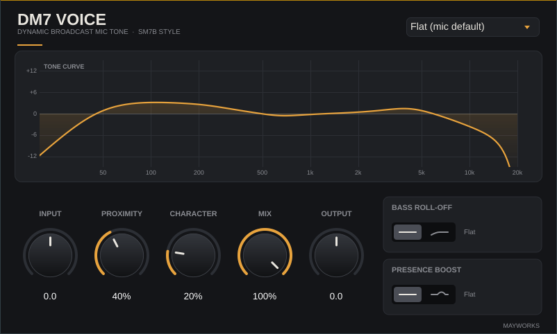

# DM7 Voice

An SM7B-style dynamic broadcast-mic tone plugin by MayWorks. Put it on a voice track
recorded with any mic (condenser, USB mic, headset) to get the warm, smooth, close-up
radio sound the Shure SM7B is known for.



Formats: VST3 (Windows / macOS / Linux), AU (macOS), and a standalone app.

## Controls

| Control | What it does |
|---|---|
| **Input** | Gain into the plugin (±18 dB). Push it to drive Character harder. |
| **Proximity** | How close you "are" to the mic: more low-end warmth as you close in (up to about +7 dB at 100 Hz). |
| **Character** | Preamp drive: thickness and gentle saturation (2× oversampled). 0% is fully clean. |
| **Mix** | Blend of the processed and original signal. |
| **Output** | Output level (±18 dB). |
| **Bass Roll-off** | Same as the switch on the back of the mic: rolls off the lows (about −8 dB at 100 Hz). |
| **Presence Boost** | Same as the mic's presence switch: a broad lift of about +6 dB around 4–5 kHz for more clarity. |

Presets: Flat (mic default), Presence Boost, Radio Broadcast, Podcast Warm, Close & Clean,
Rock Vocal, Subtle Blend.

## The tone curve (flat setting)

Low end down below ~60 Hz, a little lower-mid body around 200 Hz, a smooth midrange, a
gentle lift around 4 kHz, and a soft top that falls away above ~8–9 kHz. That rolled-off
top is the main reason an SM7B sounds smooth and not harsh.

## Installing

* **Windows:** copy `DM7 Voice.vst3` to `C:\Program Files\Common Files\VST3\`
* **macOS:** copy `DM7 Voice.vst3` to `~/Library/Audio/Plug-Ins/VST3/` and `DM7 Voice.component`
  to `~/Library/Audio/Plug-Ins/Components/`. The build is unsigned, so if macOS blocks it run
  `xattr -dr com.apple.quarantine ~/Library/Audio/Plug-Ins/VST3/"DM7 Voice.vst3"` (same for the
  `.component`).
* **Linux:** copy `DM7 Voice.vst3` to `~/.vst3/`

Then rescan plugins in your DAW (Reaper, Audition, Logic, Ableton, FL Studio, Ardour, etc.).

## Building

Requires CMake 3.22+ and a C++17 compiler. JUCE is fetched automatically.

```
cmake -B build -DCMAKE_BUILD_TYPE=Release
cmake --build build --config Release
```

Linux also needs: `libasound2-dev libx11-dev libxrandr-dev libxinerama-dev libxcursor-dev
libxext-dev libfreetype-dev libfontconfig1-dev`.

Pushing to GitHub builds Windows, macOS and Linux automatically
(`.github/workflows/build.yml`); pushing a tag such as `v1.0.0` publishes a release.

Shure and SM7B are trademarks of Shure Incorporated. This plugin is not affiliated with or
endorsed by Shure; the name is used only to describe the tone it is modelled on.
